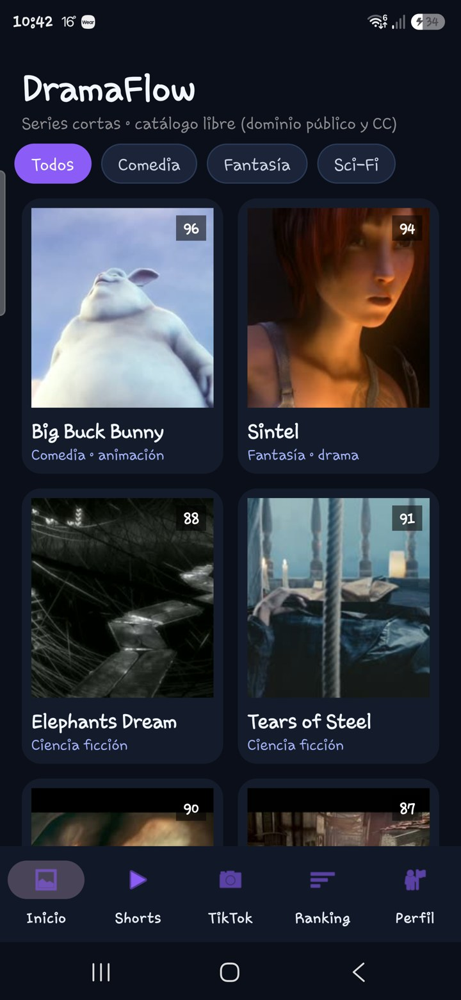
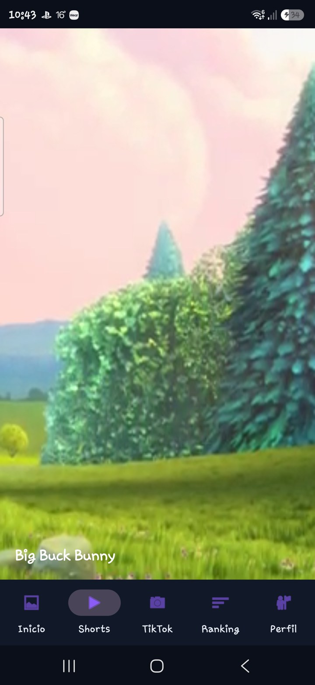
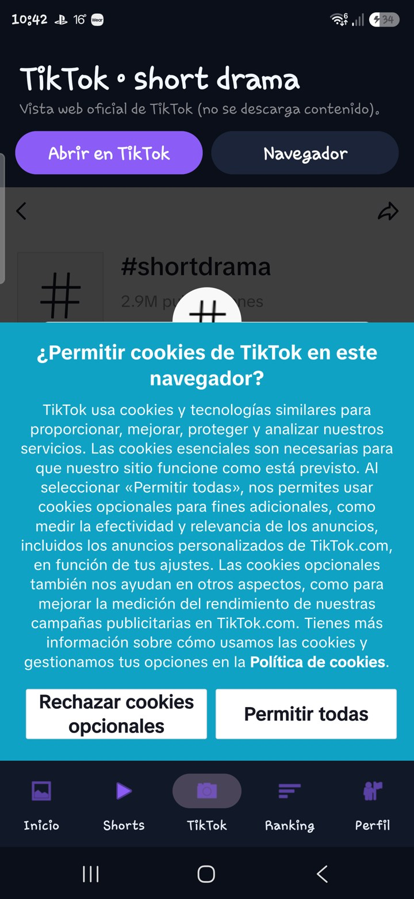

# DramaFlow

App Android de **series cortas** con catálogo de vídeos **libres** (dominio público y Creative Commons): catálogo en rejilla, reproductor vertical tipo *shorts*, ranking y perfil.

> No es un clon ni una modificación de ninguna app propietaria. Interfaz y código propios (MIT);
> el contenido de ejemplo es de Blender Foundation (CC BY) y del bucket de muestras de Google.

## Capturas (móvil real, Samsung SM-S928B)

| Catálogo | Shorts | TikTok |
|---|---|---|
|  |  |  |

## Qué incluye

- **Inicio**: catálogo en rejilla con **portada real** (fotograma extraído de cada película),
  título, género y nota; **filtros por género** (Todos/Comedia/Fantasía/Sci-Fi).
- **Shorts**: pager vertical a pantalla completa con ExoPlayer (reproduce el vídeo al deslizar).
- **TikTok**: pestaña con la vista web oficial de [tiktok.com/shortdrama](https://www.tiktok.com/shortdrama)
  y botones para abrirlo en la app de TikTok o en el navegador. No descarga ni reproduce contenido
  de TikTok fuera de su reproductor oficial.
- **Ranking**: lista ordenada por nota (★).
- **Perfil**: info de la app y licencias del contenido.
- Reproductor a pantalla completa al tocar una serie.

## Compilar

Requiere JDK 17/21 y Android SDK 34:

```bash
export JAVA_HOME=/usr/lib/jvm/java-21-openjdk
export ANDROID_HOME=$HOME/Android/Sdk
gradle assembleDebug
# APK: app/build/outputs/apk/debug/app-debug.apk
```

## Instalar

```bash
adb install -r DramaFlow-1.3-debug.apk
```

## Licencia

MIT (código). Los vídeos de ejemplo pertenecen a sus autores:
Blender Foundation (CC BY 3.0) y Google sample bucket.
